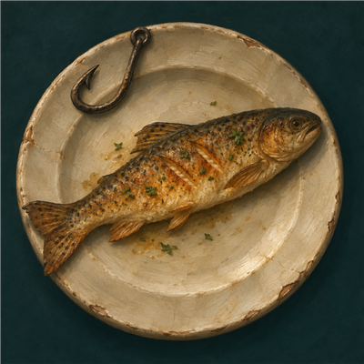

# Bait to Plate

Fishing controls, catch tracking, a seafood cooking guide and optional louder fishing splashes. The v0.9.8 beta targets Forever, Retail and the official Classic clients. See the [changelog](CHANGELOG.md) for this update.

- Bind one key to cast, then press it after the splash to reel in. Forever also supports casting and reeling through the on-screen button. On other clients, use the keybinding or right-click the bobber to catch. Classic and Forever hide the toolbar without a pole. Retail reads profession equipment and shows the controls once Fishing is learned.
- Track session and all-time catches, with item icons and a ranked catch chart. The catch window starts hidden at login and reload. Enable **Show catch stats at startup** in settings to open it automatically. Catch tracking continues while hidden.
- Check Cooking skill, known recipes, bag ingredients and exact shortages for 25 Forever seafood dishes or 22 Classic seafood recipes on other clients. Retail uses Classic Cooking skill. Expansion recipes are outside the guide, and unverified recipe sources are labelled.
- Move the fishing button, catch window, and minimap icon. The addon remembers their positions.

- Choose and apply fishing lures with a bag count and time remaining on your pole. Forever includes Camper's Lure and Secret Bait.
- Place Forever campfire kits, Fish Bowls, Fishing Racks and Fishing Huts from the camp menu. Other clients use a normal Cooking campfire.
- Show 337 known fishing-pool and fishable-wreckage locations across 17 Azeroth zones in Forever and pre-Cataclysm Classic. Toggle **Show fishing pools** in settings. Locations can be empty when visited. The overlay is disabled on later clients where the map coordinates differ.
- Enable **Louder fishing splash** and choose a **Fishing volume** from 0% to 100% (default 100%). During fishing, Master and Effects use that volume while music and ambience are muted. Your previous sound settings return when fishing ends, including after an interruption or UI reload. Changes you make to sound settings during a cast are preserved. Other sound effects are audible too. WoW supplies the bite splash and provides no reliable addon event for a separate bite alert.

## Install

Extract the included `BankFishing` folder into `Interface/AddOns` inside the WoW client folder you play. Enable **Bait to Plate** in its AddOns list. Use `/reload` after replacing an existing installation.

The v0.9.8 beta includes manifests for Forever 1.60.1, Retail 12.1.5, Classic Era 1.15.9, TBC Anniversary 2.5.6, Mists Classic 5.5.4 and Wrath Titan Reforged 3.80.2. The settings UI was checked in-game on Forever. Cross-client checks use simulated APIs, and Retail and Classic ports still need in-game testing.

Left-click the minimap icon to show or hide the fishing controls and journal. Right-click it to open settings, or right-drag it to move it. You can also type `/baittoplate` to open settings. The addon retains the `BankFishing` folder name so WoW can find existing catch history and preferences.

## License and CurseForge

The original addon source and bundled logo are available under the [Zero-Clause BSD license](LICENSE) (SPDX: `0BSD`). Anyone may use, modify, fork, or redistribute them for any purpose, without an attribution requirement. The imported GatherLite pool data and GatherGlow minimap renderer and fish artwork retain their MIT notices in [PoolData-LICENSE.txt](BankFishing/PoolData-LICENSE.txt) and [FishingPools.lua](BankFishing/FishingPools.lua).

For a CurseForge listing, select **Zero-Clause BSD (0BSD)** if listed. Otherwise select **Custom** and paste the contents of [LICENSE](LICENSE). Use the same license on both sites. The release ZIP includes a copy of the license and contains the addon folder ready to install. Publish this compatibility preview as a Beta and keep the client-testing limits in its release notes.

Use [Bait-to-Plate-Logo.png](Bait-to-Plate-Logo.png) as the CurseForge project logo. WoW artwork referenced from the installed game client belongs to Blizzard.
