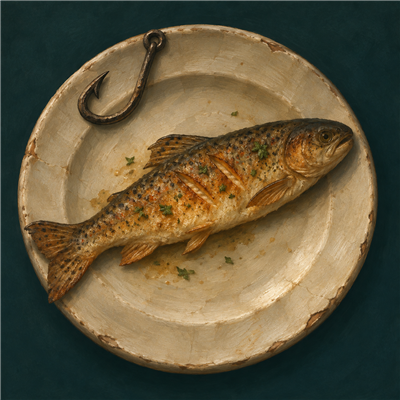

# Bait to Plate

One-button fishing for WoW Forever, with catch tracking and a cooking guide that checks your skill and bag contents.

- Click once to cast, then click again after the splash to reel in. Both actions require manual input and use WoW's built-in controls.
- Track session and all-time catches, with item icons and a ranked catch chart.
- Check Cooking skill, known recipes, bag ingredients, exact shortages, and recipe locations for 25 seafood dishes.
- Move the fishing button, catch window, and minimap icon. The addon remembers their positions.

- Choose and apply fishing lures with a bag count and time remaining on your pole.
- Place campfire kits, Fish Bowls, Fishing Racks, and Fishing Huts from the camp menu.

## Install

Download the addon ZIP from [Releases](https://github.com/Birt-tirb/bait-to-plate/releases) and extract the included `BankFishing` folder into `World of Warcraft/_forever_/Interface/AddOns/`. Enable **Bait to Plate** in the AddOns list. Use `/reload` after replacing an existing installation.

Left-click the minimap icon to show or hide the fishing controls and journal. Right-click it to open settings, or right-drag it to move it. You can also type `/baittoplate` to open settings. The addon retains the `BankFishing` folder name so WoW can find existing catch history and preferences.

## License and CurseForge

The addon source and bundled logo are available under the [Zero-Clause BSD license](LICENSE) (SPDX: `0BSD`). Anyone may use, modify, fork, or redistribute them for any purpose, without an attribution requirement.

For a CurseForge listing, select **Zero-Clause BSD (0BSD)** if listed. Otherwise select **Custom** and paste the contents of [LICENSE](LICENSE). Use the same license on both sites. The release ZIP includes a copy of the license and contains the addon folder ready to upload for the **WoW Forever** flavor.

Use [Bait-to-Plate-Logo.png](Bait-to-Plate-Logo.png) as the CurseForge project logo. WoW artwork referenced from the installed game client belongs to Blizzard.
